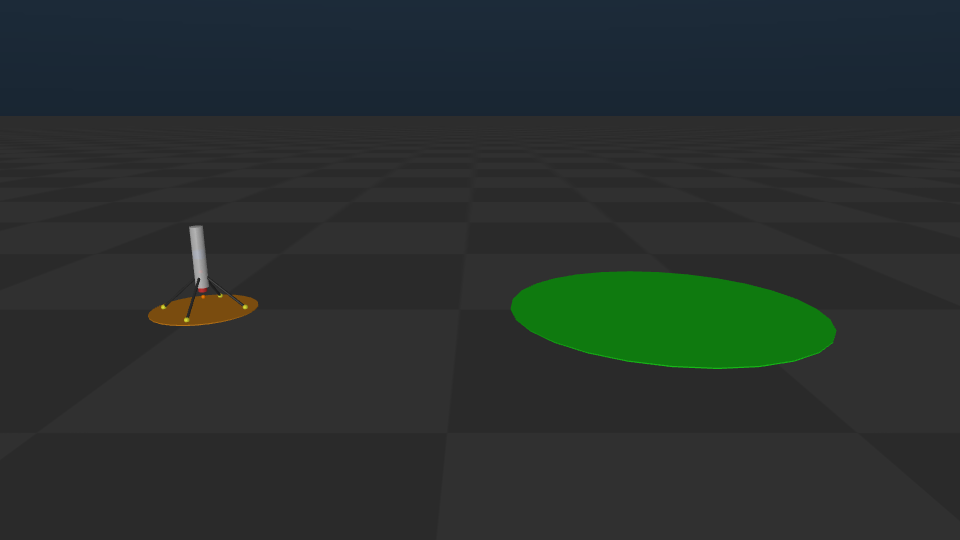
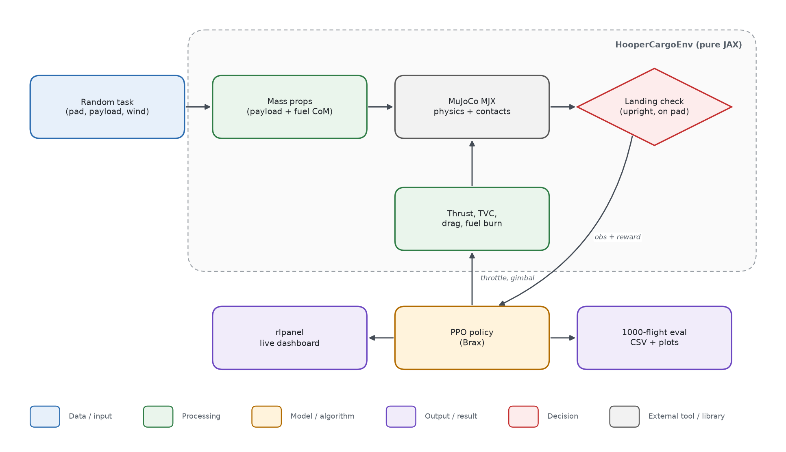
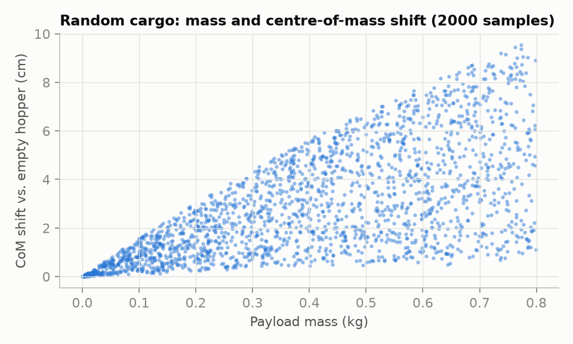
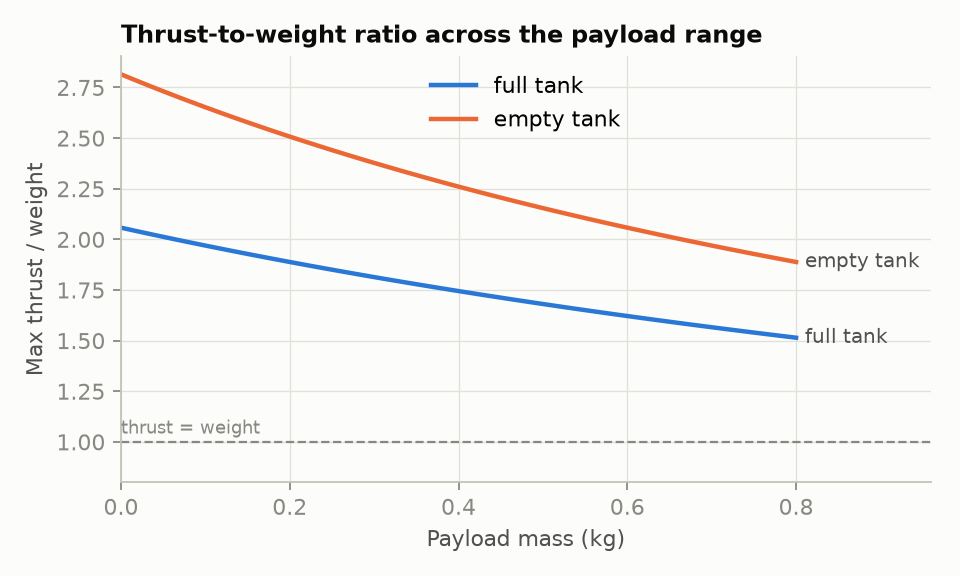

# HooperCargo

**A reinforcement-learning rocket hopper that carries random cargo to a random landing pad and lands upright, in wind, on a finite fuel tank.**

HooperCargo is the simulation proof-of-concept for fast point-to-point cargo delivery by reusable rockets instead of aircraft or ships. A ~1 m thrust-vector-controlled hopper (MuJoCo MJX, GPU-parallel JAX physics) takes off, flies 20–100 m to a pad in a random direction and must land on its legs without tipping over. Payload mass and placement, fuel burn and wind change on every flight; the controller is trained with PPO.



*The cargo hopper model on its launch pad (orange) and a landing pad (green), rendered from `assets/hooper_cargo.xml`. A flight GIF of the trained policy will replace this image after training.*

## Overview

| | |
|---|---|
| **Problem** | Fly a small rocket hopper to a random pad and land upright while the payload mass, the payload position (centre of mass), the fuel mass and the wind all vary from flight to flight. |
| **Method** | Pure-JAX MuJoCo MJX environment with physically correct mass properties (payload and fuel are weld bodies whose mass/CoM/inertia are rewritten every step), Isp-based fuel burn, quadratic wind drag with Ornstein–Uhlenbeck gusts applied at the hull's centre of pressure, engine cut-off at touchdown; Brax PPO with a 3-stage curriculum and a fresh random scenario on every episode reset; deterministic 1000-flight evaluation. |
| **Simulation / hardware** | MuJoCo 3.8 / MJX, JAX 0.7.2, Brax 0.14.2, Python 3.12. Developed and tested on Windows 11 (CPU JAX, AMD Ryzen 7 8845HS); GPU training target: RTX 4050 Laptop (6 GB) via Linux. |
| **Paper** | None yet. Part of a TÜBİTAK 1002 proposal (in preparation). |

### System architecture



Each episode samples a pad location, a cargo (mass and position inside the cargo bay) and a wind. The mass properties of the loaded vehicle are written into the MJX model, the policy commands throttle and the two gimbal angles, and the environment applies thrust, drag and fuel burn before stepping the physics. The landing check decides success or failure; PPO learns from the observations and reward, logs live to rlpanel, and the trained policy is scored on 1000 random flights.

## Selected results

> **Training has not been run yet.** The figures below describe the task the policy has to solve; they come from the environment code itself, not from a trained policy. Safe-landing rates vs payload, CoM shift and wind, the training curve and a flight GIF will be added after training.

### Random cargo moves the centre of mass by up to ~9 cm

Every flight loads 0–0.8 kg of cargo at a random point inside the cargo bay (axial 0–0.35 m, lateral ≤ 3 cm). The heavier the cargo, the further the vehicle's centre of mass moves; the controller does not observe the cargo position and has to cope with it.



### The hopper can always lift off, but heavy cargo leaves little margin

With 45 N of thrust, a 1.63 kg dry vehicle and 0.6 kg of fuel, the thrust-to-weight ratio at lift-off ranges from about 2.1 (no cargo) down to about 1.5 (0.8 kg cargo), comparable to real launch vehicles. It rises as fuel is burnt.



*All figures are in `plots/`.*

## Installation

### Requirements

- Windows 11 or Linux; Python ≥ 3.11 (tested with 3.12.10)
- CPU is enough for tests and smoke runs; full training needs an NVIDIA GPU under Linux or WSL2 (`pip install -e ".[gpu]"`, CUDA 13 build of JAX)
- ~3 GB disk for the virtual environment

### Steps

```bash
git clone https://github.com/BalBaZeuR0/HooperCargo.git
cd HooperCargo
python -m venv .venv
.venv/Scripts/python -m pip install -e ".[dev]"     # Linux: .venv/bin/python
.venv/Scripts/python -m pytest tests/test_model.py tests/test_wind.py tests/test_reward.py -q
```

Expected output:

```
..............                                                           [100%]
14 passed in 3.39s
```

The full suite (`python -m pytest -q`, 55 tests) also trains and evaluates tiny policies and takes about 11 minutes on CPU.

## Usage

### Measure simulation speed

```bash
python -m hoopercargo.train --benchmark --num-envs 1024
```

Expected output (Windows 11, CPU JAX, Ryzen 7 8845HS):

```
cpu: 1,819 env-steps/s (1024 envs)
```

### Train, evaluate, plot

```bash
# 3-stage curriculum (5-20 m calm -> 20-60 m -> 20-100 m with 0-6 m/s wind); live dashboard opens in the browser
python -m hoopercargo.train --run-dir runs/main --steps-per-stage 50e6,100e6,150e6 --num-envs 1024
# 1000 deterministic flights -> results/eval.csv
python -m hoopercargo.evaluate --params runs/main/params_stage2.pkl --episodes 1000 --seed 12345 --out results/eval.csv
# figures and flight GIF
python scripts/make_plots.py --eval results/eval.csv --progress runs/main/progress.csv --out plots/
python scripts/render_flight.py --params runs/main/params_stage2.pkl --seed 3 --out assets/demo.gif --topdown plots/trajectories.png
```

Ablation: `--no-payload-randomization` trains with a fixed 0.4 kg cargo at the bay centre and no payload-mass input (evaluation then uses random payloads, still without that input; `evaluate` reads the mode and the scale from the run's `config.json`); `--scale 2.0` trains a hopper twice as large (Froude-scaled: mass ×8, thrust ×8, same thrust-to-weight).

## Reproducing the results

| Figure | Command |
|---|---|
| `plots/task_randomization.png`, `plots/thrust_to_weight.png` | `python scripts/plot_task_design.py --out plots/` |
| `assets/hero.png` | `python -c "import sys; sys.path.insert(0, 'scripts'); from render_flight import render_still; render_still('assets/hero.png')"` |
| `assets/architecture.png` | `python scripts/flowchart.py assets/architecture.json` |
| `plots/success_vs_*.png`, `plots/training_curve.png` (after training) | `python scripts/make_plots.py --eval results/eval.csv --progress runs/main/progress.csv --out plots/` |

## Project structure

```
HooperCargo/
├── assets/             # hooper_cargo.xml (MJCF template), hero.png, architecture.png/.json
├── hoopercargo/
│   ├── config.py       # physical constants, Froude scaling, curriculum stages
│   ├── model.py        # builds the MuJoCo model at any scale
│   ├── payload.py      # cargo sampling, payload/fuel mass properties
│   ├── wind.py         # mean wind + OU gusts, drag force
│   ├── reward.py       # guidance velocity field, reward terms
│   ├── env.py          # HooperCargoEnv (Brax/MJX environment)
│   ├── train.py        # PPO + curriculum + rlpanel
│   └── evaluate.py     # deterministic N-flight evaluation -> CSV
├── scripts/            # plots, flight rendering, flowchart
├── plots/              # result figures
├── tests/              # pytest suite
├── docs/superpowers/   # design spec and implementation plan
└── pyproject.toml
```

## Citation, license, contact

The hopper model and the TVC/thrust structure of the environment are derived from [GulogluHaktan/3DRocketRl](https://github.com/GulogluHaktan/3DRocketRl). The motivation, a ~96% fall in launch cost per kilogram since 1960, is from Terzi & Nicoli (2026), *PNAS Nexus* 5(7), [doi:10.1093/pnasnexus/pgag217](https://doi.org/10.1093/pnasnexus/pgag217).

```bibtex
@misc{hoopercargo2026,
  title  = {HooperCargo: Reinforcement-Learning Rocket Hopper for Point-to-Point Cargo Landing},
  author = {{BalBaZeuR0}},
  year   = {2026},
  howpublished = {\url{https://github.com/BalBaZeuR0/HooperCargo}}
}
```

License: to be decided. Contact: [@BalBaZeuR0](https://github.com/BalBaZeuR0), MTA Artificial Intelligence Center.
